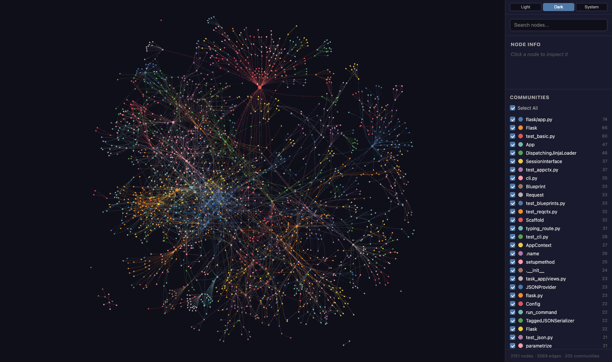

<div align="center">

# OneGraph

### Graphify builds the real dependency graph. Gemma 4 narrates it. $0 LLM cost to build it.

[](https://graphs-site-omega.vercel.app/graphs/showcase-flask.html)
[](https://graphs-site-omega.vercel.app/graphs/showcase-flask.html)
[](https://graphs-site-omega.vercel.app/graphs/showcase-flask.html)
[](https://graphs-site-omega.vercel.app/graphs/showcase-flask.html)

Built at **Hacktoberfest Hack Day Pune × GDG on Campus - VU**, 2026-10-22.
Sponsor tool: **Graphify**. Tracks: **Best Use of Gemma 4** · **Best Open-Source AI Project**

[**Open the live graph**](https://graphs-site-omega.vercel.app/graphs/showcase-flask.html) · [**Live PR demo**](https://github.com/CodersAcademy006/onegraph-flask-demo/pull/1) · [**Landing page**](https://graphs-site-omega.vercel.app/)

<a href="https://graphs-site-omega.vercel.app/graphs/showcase-flask.html">
  
</a>

<sub>Real output of <code>graphify export html</code> on <a href="https://github.com/pallets/flask">pallets/flask</a> — not a mockup. Every dot above is a real function, class, or file; every line a real call/import edge.</sub>

</div>

---

## How it works

```
repo ──▶ graphify extract   (tree-sitter AST, $0 LLM)         onegraph-core/core.py
      ──▶ graphify label     (names every community)
      ──▶ graphify export html  (Graphify's own interactive viewer)
      ──▶ deploy to Vercel   (public link, posted in the PR comment)

PR diff ──▶ graphify affected <symbol>  (real blast radius, not a guess)
         ──▶ Gemma 4 / Gemini API        (writes the plain-English risk review)
         ──▶ PR-Agent `/graph_risk`      (posts stats + risk review + graph link)
```

Nothing here re-implements Graphify's UI. `graphify export html` already
produces a sponsor-native, fully standalone, force-directed graph viewer
(vis-network, click-to-inspect sidebar, named/color-coded communities) — we
run it on the real repo and host the output, nothing more.

## Layout

- **`onegraph-core/core.py`** — the shared library both front ends use.
  Shells out to the real `graphify` CLI (no Python bindings exist), calls
  Gemma 4 via the raw Gemini API, deploys the exported graph to Vercel.
  `test_core.py` is the smoke test.
- **`pr-agent-integration/`** — the `/graph_risk` command wired into
  [qodo-ai/pr-agent](https://github.com/qodo-ai/pr-agent). `pr_graph_risk.py`
  is the tool itself; `pr_agent.py.diff` is the 2-line registration diff
  against pr-agent's `command2class` map. Run it with:
  ```
  GITHUB__USER_TOKEN=$(gh auth token) CONFIG__GIT_PROVIDER=github \
    pr-agent --pr_url <pr-url> graph_risk
  ```
- **`graphs-site/`** — the static site: landing page + one hosted
  `graph.html` per repo/PR, deployed to Vercel on every `/graph_risk` run.

## Why this exists

A PR review that says "this looks risky" without showing *why* is a guess. A
dependency graph without real structure (hand-waved boxes and arrows) is
also a guess. OneGraph grounds both halves in the same real graph: Graphify
extracts it once, cheaply and deterministically; Gemma 4 only ever talks
about nodes and edges that are actually there.
