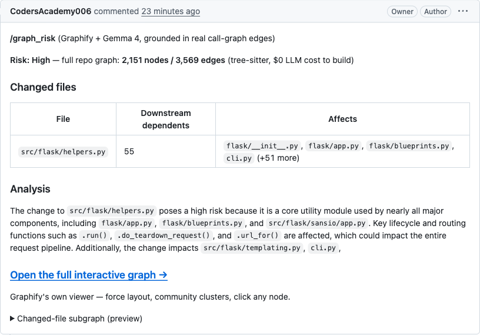
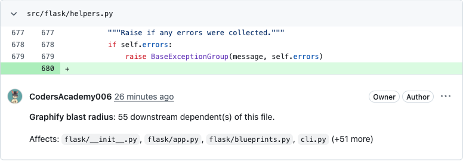
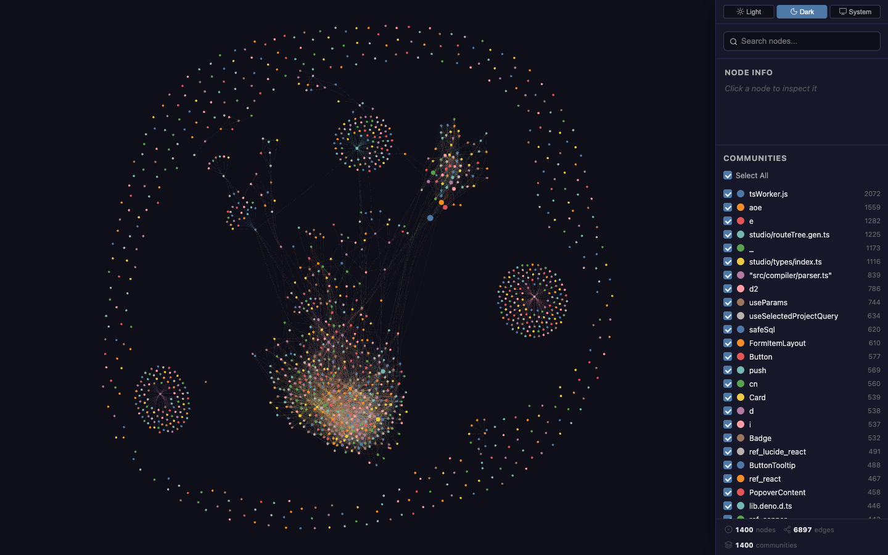
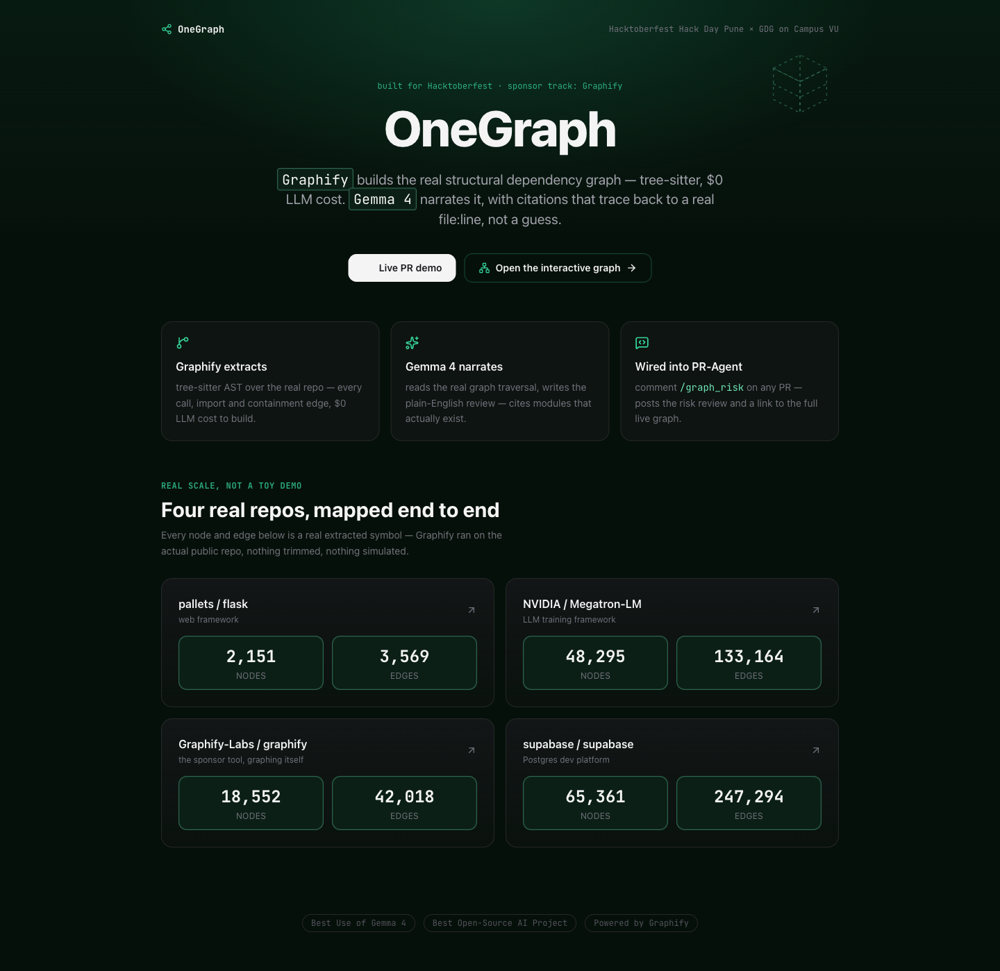

<div align="center">

# OneGraph

### Graphify constructs the real dependency graph. Gemma 4 narrates it. Zero dollar LLM cost to build.

[](https://github.com/CodersAcademy006/onegraph/stargazers)
[](https://github.com/CodersAcademy006/onegraph/network/members)
[](LICENSE)
[](https://python.org)
[](https://graphs-site-omega.vercel.app/)

[](https://graphs-site-omega.vercel.app/)
[](https://graphs-site-omega.vercel.app/)
[](https://graphs-site-omega.vercel.app/)
[](https://github.com/Graphify-Labs/graphify)
[](https://ai.google.dev/)

<p align="center">
  <b>Built for Hacktoberfest Hack Day Pune × GDG on Campus - VU (October 2026)</b><br>
  Target Tracks: <b>Best Use of Gemma 4</b> | <b>Best Open-Source AI Project</b>
</p>

[**Interactive Landing Page**](https://graphs-site-omega.vercel.app/) | [**Live PR Code Review Demo**](https://github.com/CodersAcademy006/onegraph-flask-demo/pull/1) | [**Showcase Graphs**](#hosted-showcase-graphs)

<a href="https://graphs-site-omega.vercel.app/graphs/showcase-flask.html">
  
</a>

<p align="center">
  <sub>Figure 1: Standalone interactive dependency viewer for <code>pallets/flask</code>. Every node is a validated symbol; every line is a verified AST call or import relation.</sub>
</p>

</div>

---

## Executive Summary

A code review that says a change "looks risky" without showing why is a guess. An LLM asked to judge blast radius from raw diff text alone has no way to see the call chain beyond what fits in the prompt, so it is left to infer downstream impact rather than trace it.

OneGraph grounds AI code analysis in a real, deterministic dependency graph instead:

1. **Deterministic AST Extraction ($0 LLM Cost)**: Tree-sitter and Graphify scan the target repository to map all call, import, and containment relations with mathematical precision.
2. **Community Clustering and Labelling**: Community detection groups related sub-graphs into architectural domains with semantic naming.
3. **Exact Blast-Radius Graph Traversal**: On incoming pull requests, git diff symbols are mapped against the graph. Every transitive downstream dependent is deterministically extracted.
4. **Grounded Synthesis with Gemma 4**: Gemma 4 receives the exact subgraph traversal as grounded context. It writes concise, accurate risk reviews citing solely verified files and functions.
5. **Interactive Self-Contained Web Artifacts**: Standalone force-directed graph viewers are built and deployed automatically to Vercel, providing reviewers with full interactive visual context.

---

## Hosted Showcase Graphs

The pipeline has been executed against production repositories to demonstrate performance across varying scale:

| Target Repository | Domain | Nodes | Edges | Communities | Interactive Graph |
| :--- | :--- | :---: | :---: | :---: | :---: |
| **pallets / flask** | Web Framework | 2,151 | 3,569 | 205 | [Launch Graph](https://graphs-site-omega.vercel.app/graphs/showcase-flask.html) |
| **NVIDIA / Megatron-LM** | Distributed LLM Training | 48,295 | 133,164 | 1,275 | [Launch Graph](https://graphs-site-omega.vercel.app/graphs/megatron-lm.html) |
| **Graphify-Labs / graphify** | Graph Extraction Engine (Meta) | 18,552 | 42,018 | 865 | [Launch Graph](https://graphs-site-omega.vercel.app/graphs/graphify-self.html) |
| **supabase / supabase** | Distributed Cloud Platform | 65,361 | 247,294 | 1,400 | [Launch Graph](https://graphs-site-omega.vercel.app/graphs/supabase.html) |

<sub>Every figure above is read directly from Graphify's own extracted `graph.json`: the true total, not a display-trimmed subset. For graphs above 6,000 raw nodes, the interactive viewer renders community-level clusters rather than every individual node, purely for browser render load; the underlying counts are unaffected.</sub>

---

## Visual Demonstration

### 1. Automated Pull Request Code Review

When triggered on a GitHub pull request via `/graph_risk`, OneGraph analyzes the diff, traverses affected symbols, synthesizes the risk assessment using Gemma 4, and publishes the review directly to the PR discussion.

<div align="center">
  
  <p><sub>Figure 2: Production PR review comment on GitHub showing real blast-radius data and direct link to the deployed interactive visualizer.</sub></p>
</div>

### 2. Inline Diff Impact Analysis

OneGraph can anchor specific blast-radius insights directly to modified lines within the pull request diff view.

<div align="center">
  
  <p><sub>Figure 3: Line-anchored code review verifying downstream callers affected by the diff.</sub></p>
</div>

### 3. Enterprise Scale Visualization: Supabase

Extracted from a 1.5 GB TypeScript monorepo that also carries Elixir, SQL migrations, and Docker tooling, illustrating system performance on large multi-service architectures.

<div align="center">
  <a href="https://graphs-site-omega.vercel.app/graphs/supabase.html">
    
  </a>
  <p><sub>Figure 4: Monorepo visualization of 65,361 nodes and 247,294 edges from <code>supabase/supabase</code>.</sub></p>
</div>

### 4. Interactive Portal

The central landing page showcases active graphs, system architecture, and PR-Agent command integration.

<div align="center">
  <a href="https://graphs-site-omega.vercel.app/">
    
  </a>
  <p><sub>Figure 5: OneGraph production portal hosted on Vercel.</sub></p>
</div>

---

## System Architecture

```
Repository Source Code
         │
         ▼
[1] graphify extract
    - Tree-sitter AST parser
    - Call, import, and inheritance graph
    - Deterministic extraction ($0 LLM cost)
         │
         ▼
[2] graphify label
    - Community detection (Leiden / Louvain)
    - Semantic domain labelling
         │
         ▼
[3] graphify export html + onegraph polish
    - Vis-network physics simulation
    - Dynamic label scaling on zoom
    - Apple-inspired design tokens and translucent glass styling
    - Automated production deployment to Vercel
         │
         ▼
[4] Pull Request Event (/graph_risk)
    - Git diff symbol extraction
    - Blast-radius traversal via graphify affected
    - Grounded synthesis through Gemma 4
    - Automated review posted to GitHub PR
```

---

## Repository Structure

```
onegraph/
├── onegraph-core/
│   ├── core.py               # Central engine: graph build, export, deploy, risk analysis
│   ├── test_core.py          # Integration test suite
│   ├── ab_proof.py           # Controlled comparative test: Gemma 4 vs baseline
│   └── AB_PROOF_RESULTS.md   # Benchmark metrics and proof records
├── pr-agent-integration/
│   ├── pr_graph_risk.py      # Native PR-Agent tool implementation
│   └── pr_agent.py.diff      # Two-line patch registering /graph_risk command
├── graphs-site/
│   ├── index.html            # Production landing portal with live showcase gallery
│   └── graphs/               # Deployed standalone interactive HTML visualizers
└── docs/                     # Production visual assets and documentation screenshots
```

---

## Quickstart and Usage

### Prerequisites

- Python 3.10 or higher
- Node.js (for optional Vercel CLI deployments)
- Graphify CLI installed (`uv tool install graphifyy`)
- Google Gemini API key with access to Gemma 4 / Gemini models

### Environment Configuration

```bash
export GEMINI_API_KEY="your-gemini-api-key"
export GITHUB__USER_TOKEN="your-github-personal-access-token"
export VERCEL_TOKEN="your-vercel-token" # optional for deployment
```

### Python API

```python
import sys
sys.path.insert(0, "onegraph-core")

from pathlib import Path
from core import build_graph, export_graph_html, analyze_risk, graph_stats

# Pass an absolute, resolved path. build_graph and export_graph_html shell
# out with cwd set to this path, so a relative Path is silently re-resolved
# against the wrong directory and the graphify calls fail.
repo_path = Path("./my-project").resolve()

# 1. Build dependency graph deterministically
build_graph(repo_path)

# 2. Extract topological statistics
nodes, edges = graph_stats(repo_path)
print(f"Extracted {nodes} nodes and {edges} edges.")

# 3. Export standalone interactive HTML viewer
html_path = export_graph_html(repo_path)
print(f"Interactive graph generated at {html_path}")

# 4. Analyze pull request risk for specific changed symbols
risk_summary = analyze_risk(repo_path, ["src/auth/jwt.py", "src/models/user.py"])
print(f"Grounded risk review:\n{risk_summary}")
```

### PR-Agent Integration

Trigger risk analysis on any public or private pull request:

```bash
GITHUB__USER_TOKEN=$(gh auth token) CONFIG__GIT_PROVIDER=github \
  pr-agent --pr_url https://github.com/org/repo/pull/1 graph_risk
```

---

## Verification: graph retrieval versus keyword retrieval

[`onegraph-core/ab_proof.py`](onegraph-core/ab_proof.py) runs the same
question through Gemma 4 twice against `pallets/flask`: once with a naive
keyword-matched snippet baseline, once with Graphify's real graph traversal
as context. Both runs check every citation the model makes against the
actual file and line on disk.

The honest, reproducible result, recorded in full in
[`onegraph-core/AB_PROOF_RESULTS.md`](onegraph-core/AB_PROOF_RESULTS.md), is
not that the keyword baseline hallucinated. Given verbatim, line-numbered
snippets, Gemma 4 cited only what was literally in front of it: 2 out of 2
citations real. The real difference is coverage. The baseline's keyword
search happened to land on `dispatch_request` and stopped there, missing
`full_dispatch_request`, `wsgi_app`, and `views.py` entirely. Graphify's
traversal surfaced the complete cross-file call chain, `wsgi_app` to
`full_dispatch_request` to `dispatch_request` to `Scaffold.add_url_rule` to
`View`, 6 out of 6 citations real. Keyword search finds a word; graph
traversal finds the chain.

---

## License

This project is licensed under the MIT License. See the [LICENSE](LICENSE) file for details.
